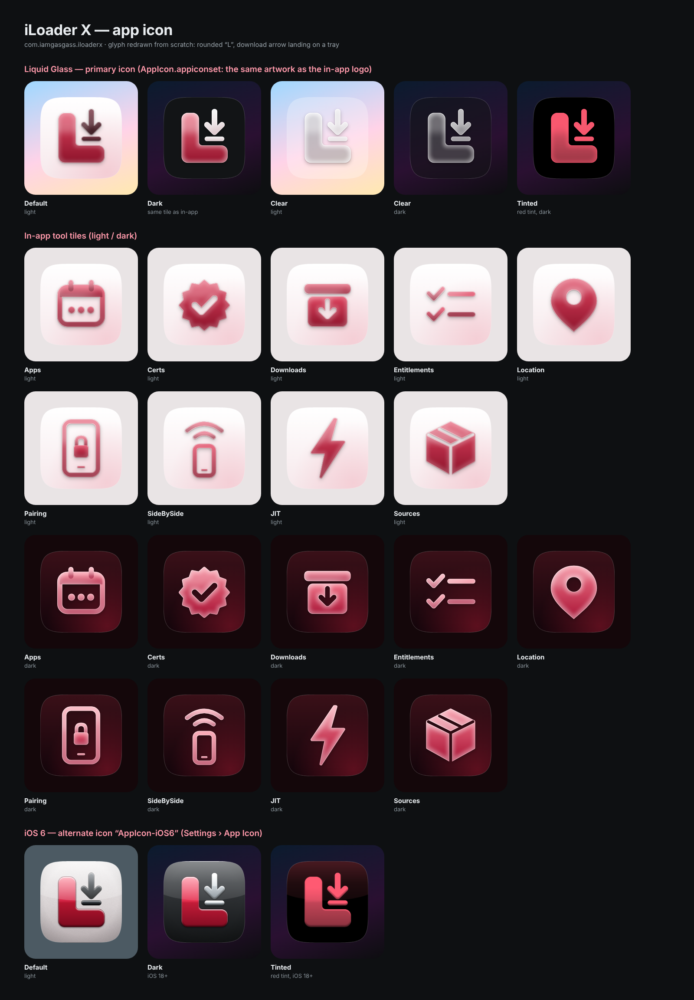

<div align="center">


# iLoader X

**Install SideStore and LiveContainer directly on your iPhone. No PC required.**

Bundle ID `com.iamgasgass.iloaderx` · iOS 17.4+ (iOS 27 pairs with itself)

</div>

---

iLoader X is a fork of **[SideInstaller by FrizzleM](https://github.com/FrizzleM/SideInstaller)**
(version 2.1.1, commit `141d7ee`), redistributed in source form under its
[licence](LICENSE.md). Everything that does the work (on-device pairing,
provisioning, signing and installing SideStore, LiveContainer and other IPAs)
is SideInstaller's; iLoader X gives it its own name, bundle ID and icon.

> [!IMPORTANT]
> iLoader X is **not** the official SideInstaller and is not affiliated with FrizzleM.
> For the original app, go to <https://github.com/FrizzleM/SideInstaller>.
> Problems with this fork belong in this repository's issues, not in SideInstaller's.

## The icon

Drawn from scratch for iLoader X: a rounded “L” with a download arrow landing on
a tray in the notch. Two looks, each with every appearance iOS asks for:



| | Where | Variants |
|---|---|---|
| **Liquid Glass** (primary) | `ios-app/AppIcon.icon` (Icon Composer, iOS 26+) | Default, Dark, Clear light, Clear dark, Tinted light, Tinted dark: drawn by the system from three glass layers (L, arrow, tray) in two groups, each with its own fill per appearance |
| | `ios-app/Assets.xcassets/AppIcon.appiconset` (iOS 17.4 – 25) | every iPhone, iPad, CarPlay and App Store size; Dark and Tinted (iOS 18+) |
| **iOS 6** (alternate) | `ios-app/Assets.xcassets/AppIcon-iOS6.appiconset` | linen backdrop, beveled emerald gel “L”, embossed gunmetal arrow, the gloss arc baked in; every size, plus Dark (chrome arrow on charcoal) and Tinted |

Switch between them in **Settings › App Icon**. The artwork is generated from
code, so it can be regenerated at any size:

```sh
node tools/icon/render.mjs build/icon        # masters + Icon Composer layers + preview sheet (Playwright/Chromium)
python3 tools/icon/build_assets.py build/icon # asset catalog sets, AppIcon.icon, docs/
```

## Building

On a Mac with Xcode 27 (iOS 27 SDK), Rust with `aarch64-apple-ios` and `xcodegen`:

```sh
scripts/build-ipa.sh     # → build/iLoaderX.ipa, unsigned
```

On GitHub, `.github/workflows/build.yml` does the same on `macos-26` and puts
`iLoaderX.ipa` on the rolling release **iloaderx-latest**. Sign it with SideStore,
AltStore, iLoader or Sideloadly, or install it with TrollStore.

## What this fork changes

Compared with SideInstaller 2.1.1 (`141d7ee`), as its licence asks:

- **Name**: “iLoader X” everywhere the app shows its name, in all ten languages
  (product/target `iLoaderX`, `iLoaderXTests`, `iLoaderXLiveActivity`; the
  pairing name in Settings › Developer Mode and the certificate's machine name
  are “iLoader X”).
- **Identifiers**: bundle ID `com.iamgasgass.iloaderx` (Live Activity
  `.LiveActivity`, tests `.tests`); URL scheme `iloaderx://`; document types
  `com.iamgasgass.iloaderx.ipa` / `.mobiledevicepairing`; keychain service
  `com.iamgasgass.iloaderx.appleID`. It installs beside SideInstaller and shares
  nothing with it.
- **Icon**: new artwork, Liquid Glass primary and iOS 6 alternate (above), the
  in-app logo, and a Settings › App Icon picker (`ios-app/AppIconPicker.swift`).
- **Updates, Side by Side, problem reports**: read from / sent to this
  repository (release `iloaderx-latest`, its issues), not FrizzleM's.
- **Official-source check**: points to this fork's releases instead of
  sideinstaller.net.
- **About**: links this fork's source and credits SideInstaller by FrizzleM.
- **Removed** what only the official SideInstaller publishes: the
  sideinstaller.net pages, the AltSource (`frizzlem.json`), the DNS profile, and
  the release/signing/Pages workflows. Added `build.yml` and
  `scripts/patch-xcodeproj.sh` (marks `AppIcon.icon` as an Icon Composer file
  after `xcodegen`).
- Internal names that never show (the Rust core, `SideInstallerFFI`, Swift type
  names) are unchanged, so upstream changes merge cleanly.

## Licence

[SideInstaller License](LICENSE.md), © 2026 FrizzleM: non-commercial; source
redistribution with this licence, attribution and the changes listed above. iLoader X
is not sold or monetized in any way.
