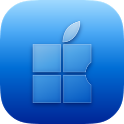
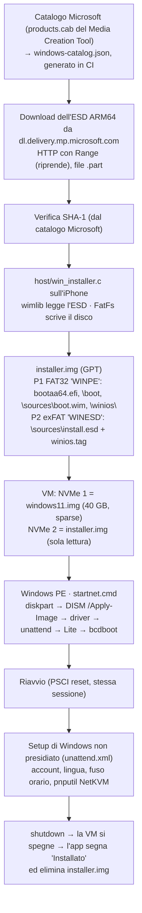
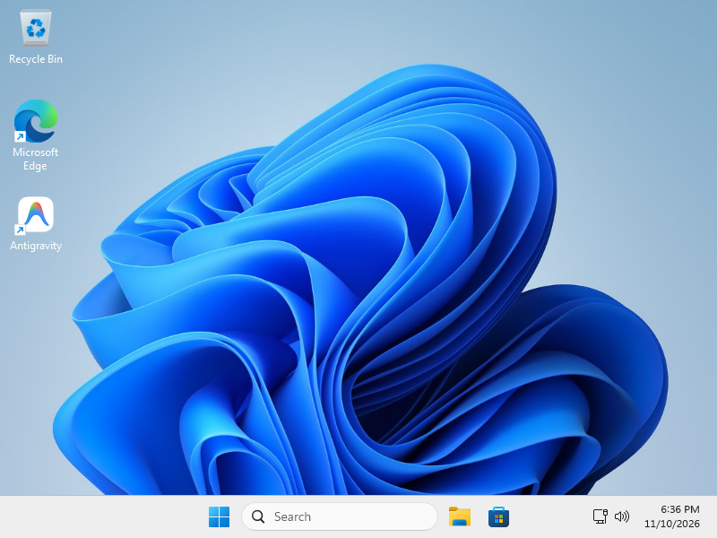
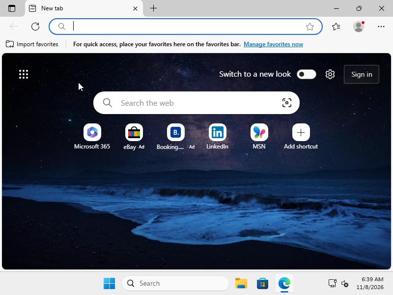

<div align="center">



# WindowsiOS X

**Windows 11 ARM64 su iPhone e iPad, senza jailbreak, senza Mac e senza PC.**
Si installa direttamente sul telefono, come [Henge](https://github.com/Leviidev/Henge) installa macOS.

`com.iamgasgass.windowsiosx` · iOS 17+ · chip A14 / M1 o successivo · licenza GPL

</div>

---

> **In una riga:** WindowsiOS X è un fork di [`ammaarreshi/WindowsiOS`](https://github.com/ammaarreshi/WindowsiOS)
> (che funzionava solo sull'iPhone Duo e richiedeva un Mac per preparare Windows). Questo fork funziona su
> **tutti gli iPhone compatibili** e **scarica e installa Windows 11 da solo, sull'iPhone**.

## Indice

1. [Cos'è](#1-cosè)
2. [Cosa cambia rispetto all'originale](#2-cosa-cambia-rispetto-alloriginale)
3. [Dispositivi compatibili](#3-dispositivi-compatibili)
4. [Installazione passo per passo](#4-installazione-passo-per-passo)
5. [Come funziona l'installazione sull'iPhone](#5-come-funziona-linstallazione-sulliphone)
6. [Il disco "WindowsiOS X Tools"](#6-il-disco-windowsios-x-tools)
7. [Impostazioni: memoria, vCPU, Lite](#7-impostazioni-memoria-vcpu-lite)
8. [Interfaccia: modalità Laptop e Studio](#8-interfaccia-modalità-laptop-e-studio)
9. [Aggiornare, reinstallare, migrare](#9-aggiornare-reinstallare-migrare)
10. [Risoluzione dei problemi](#10-risoluzione-dei-problemi)
11. [Compilare l'app](#11-compilare-lapp)
12. [Struttura del repository](#12-struttura-del-repository)
13. [Cosa è verificato e cosa no](#13-cosa-è-verificato-e-cosa-no)
14. [Il motore (dall'originale)](#14-il-motore-dalloriginale)
15. [Crediti e licenze](#15-crediti-e-licenze)

---

## 1. Cos'è

WindowsiOS X esegue **Windows 11 Pro ARM64 originale e non modificato** dentro un'app iOS. Non usa
`Hypervisor.framework`, che Apple ha tolto agli iPhone non jailbroken. Usa invece:

- un **traduttore binario dinamico ARM64 → ARM64** (JIT) con MMU software a pagine da 4 KB, scritto per
  quello che chiede il kernel di Windows (`ntoskrnl.exe`);
- un **PC virtuale completo**: UEFI (EDK2), ACPI 6.3, GICv3 con ITS/MSI-X, PCIe, disco NVMe, USB 3.0
  (tastiera e tablet), audio Intel HD (altoparlante e microfono), rete VirtIO;
- un'**interfaccia iOS** che fa da portatile: schermo sopra, tastiera e trackpad sotto.

Il JIT richiede il debugger per abilitare la memoria eseguibile (iOS 26/27 con TXM): si attiva con
[StikDebug](https://github.com/StephenDev0/StikDebug) dal telefono, oppure da un Mac con lo script di lancio.

## 2. Cosa cambia rispetto all'originale

| | WindowsiOS (originale) | **WindowsiOS X** |
| :--- | :--- | :--- |
| Dispositivi | solo iPhone Duo (`iPhone19,4`, 12 GB) | ogni iPhone/iPad con **A14 / M1 o successivo** |
| Memoria per Windows | fissa, 4,5 GB | **scelta in base alla RAM del dispositivo** (2–4,5 GB), modificabile |
| Area JIT | fissa, 384 MB | 256 / 320 / 384 MB in base alla RAM |
| vCPU | fisse, 4 | 2–4 in base al dispositivo, modificabili |
| Chip troppo vecchio | crash (`SIGILL`) | **messaggio chiaro** all'avvio |
| Preparazione di Windows | **su un Mac** (WinPE, DISM, script Python) | **sull'iPhone**, con un tocco |
| Download di Windows | a mano, sul Mac | **dall'app**, dai server Microsoft, con ripresa e verifica SHA-1 |
| Driver di rete | non installato automaticamente | **NetKVM** installato in fase di installazione e al primo accesso, più il disco **Tools** |
| Interfaccia senza cerniera | pensata per il pieghevole | **verticale = Laptop, orizzontale = Studio** su ogni iPhone |
| Firma | team e profilo dell'autore | firma automatica, bundle ID `com.iamgasgass.windowsiosx` |
| Compilazione | solo su Mac | **GitHub Actions** produce l'IPA non firmata |
| Xcode | iOS 27.1 SDK obbligatorio | **qualsiasi Xcode recente**: il sensore cerniera si compila solo se l'SDK lo ha |
| Icona | — | icona dedicata (dall'icona di Husk, adattata al logo Windows) |
| Nome | Windows 11 | **WindowsiOS X** |

## 3. Dispositivi compatibili

La regola è la stessa di Henge: **iOS 17 o successivo, chip A14 / M1 o più recente**. La CPU virtuale dichiara
a Windows istruzioni Armv8.5 (`core/sysreg.c`, ad esempio `FRINTTS`, `SB`, `LRCPC2`), e il JIT le passa così
come sono al processore dell'iPhone. Un A13 o precedente non le ha: l'app lo rileva
(`hw.optional.arm.FEAT_*`, o in mancanza il modello) e mostra un messaggio invece di avviarsi.

| RAM del dispositivo | iPhone | Memoria a Windows (auto) | Area JIT | vCPU | Stato |
| :--- | :--- | :---: | :---: | :---: | :--- |
| 12 GB | iPhone 17 Pro / Pro Max, iPhone Air, **iPhone Duo** | 4608 MB | 384 MB | 4 | ✅ |
| 8 GB | iPhone 15 Pro / Pro Max, 16 / 16 Plus / 16 Pro / 16 Pro Max / 16e, 17 | 3584 MB | 384 MB | 4 | ✅ |
| 6 GB | iPhone 12 Pro / Pro Max, 13 Pro / Pro Max, 14 / 14 Plus / 14 Pro / Pro Max, 15 / 15 Plus | 2560 MB | 320 MB | 4 | ✅ (**provato su iPhone 14 Pro**) |
| 4 GB | iPhone 12 / 12 mini, 13 / 13 mini, SE (3ª gen.) | 2048 MB | 256 MB | 2 | ⚠️ sperimentale, usa **Lite** |
| — | iPad con A14 / M1 o successivo | in base alla RAM | | | ✅ (layout Studio) |
| — | iPhone 11 e precedenti (A13 o più vecchi) | — | — | — | ❌ chip troppo vecchio |

La fascia si sceglie dalla RAM che il dispositivo dichiara (`hw.memsize`), non dal nome del modello: i
modelli futuri sono coperti automaticamente. All'avvio Windows riceve sempre al massimo quello che lascia
**almeno 1,5 GB a iOS**. Se la memoria non basta, l'app riprova scendendo di 512 MB alla volta.

## 4. Installazione passo per passo

**Servono:** un iPhone compatibile con **almeno 30 GB liberi**, SideStore / AltStore / TrollStore,
[StikDebug](https://github.com/StephenDev0/StikDebug) per il JIT, Wi-Fi e il telefono in carica.

1. **Installa l'app.** Scarica `WindowsiOS-X.ipa` da GitHub (*Actions → Build IPA → ultima run → Artifacts*,
   oppure dalla pagina *Releases*) e caricala con SideStore, AltStore o TrollStore.
2. **Aprila.** Nella scheda iniziale vedi il modello, la RAM e cosa verrà dato a Windows, ad esempio
   `IPHONE 14 PRO · 6 GB · 2560 MB / 4 VCPU`. Toccando quella riga apri le impostazioni.
3. **Tocca _INSTALL WINDOWS 11_.** Si apre la schermata di installazione, impostata come quella di Henge:
   - **Versione:** Windows 11 Pro ARM64 nelle 38 lingue del catalogo Microsoft; è già proposta quella
     dell'iPhone. In alternativa puoi **importare un `.esd`** dall'app File o da iCloud.
   - **Nome account:** account locale senza password, con accesso automatico.
   - **Lite:** consigliato su iPhone da 4–6 GB (vedi [sezione 7](#7-impostazioni-memoria-vcpu-lite)).
   - **Elimina il download dopo l'installazione:** libera circa 5 GB.
   - In fondo l'app indica **quanto spazio serve e quanto ne hai libero**.
4. **Tocca _Install Windows 11_.** L'app:
   1. scarica Windows dai server Microsoft (circa 5 GB, riprende se si interrompe);
   2. controlla l'hash SHA-1 del file;
   3. prepara sull'iPhone il disco di installazione (alcuni minuti).
5. **Attiva il JIT** quando l'app lo chiede (*Enable JIT (StikDebug)*), poi tocca *JIT is on: install*.
6. **Guarda Windows che si installa.** Puoi chiudere il foglio e vedere lo schermo della VM:
   Windows PE (7 passaggi numerati) → riavvio → configurazione di Windows (automatica) → spegnimento.
   **Tieni l'app aperta e l'iPhone in carica.** Stima: 1–2 ore.
7. **Chiudi l'app** (scorri verso l'alto), riaprila con il JIT e tocca **BOOT WINDOWS 11**.
8. **Rete:** se Windows dice *"impossibile rilevare l'hardware di rete"*, apri l'unità **WINIOSTOOLS** (D:)
   ed esegui **`Installa-driver.cmd`** (vedi [sezione 6](#6-il-disco-windowsios-x-tools)).

Se chiudi l'app durante l'installazione nella VM, alla riapertura **riprende da sola** con il disco
d'installazione ancora collegato.

## 5. Come funziona l'installazione sull'iPhone



### 5.1 Catalogo
`scripts/make_windows_catalog.py` gira su GitHub Actions. Scarica `products.cab` dal link ufficiale del Media
Creation Tool di Windows 11 (`go.microsoft.com/fwlink/?LinkId=2156292`), lo estrae e tiene gli **ESD ARM64
consumer** (Home + Pro), uno per lingua. Per ogni lingua salva nome del file, URL, dimensione, **SHA-1** e
build (ad esempio `26100.4349`). Il risultato, `windows-catalog.json`, va nell'app. Nell'ultima build
contiene **38 lingue**.

### 5.2 Download
- Il server dei file ESD, `dl.delivery.mp.microsoft.com`, **presenta in HTTPS un certificato intestato a
  un altro nome**, e iOS lo rifiuta. Come il Media Creation Tool, l'app scarica in **HTTP**: l'eccezione ATS
  in `Info.plist` vale **solo per quel dominio**.
- L'integrità è garantita dallo **SHA-1 del catalogo Microsoft**: se non coincide, il file viene cancellato.
- Il download scrive su `Machines/Downloads/<nome>.esd.part` a blocchi, con `Range: bytes=N-`. Dopo
  un'interruzione riprende da dove era arrivato, fino a 30 tentativi. Gli errori di certificato fermano il
  download con un messaggio, invece di riprovare all'infinito.

### 5.3 Disco di installazione (`host/win_installer.c`)
Le app iOS non possono montare dischi. Il disco quindi viene **scritto direttamente nel file immagine**:
- **wimlib** (compilata per iOS in `scripts/build_ios_deps.sh`) legge l'ESD, trova l'edizione con
  `EDITIONID = Professional` e architettura ARM64, ed estrae i file di avvio UEFI dell'immagine 1
  (`\efi`, `\boot`, `\bootmgr.efi`). Esporta poi Windows PE (immagine 2) come `boot.wim` (XPRESS) e vi
  inserisce il nostro `startnet.cmd`.
- **FatFs** (in `third_party/fatfs`) scrive la tabella **GPT** (MBR protettivo, intestazioni e copia di
  riserva con CRC32), formatta la partizione 1 in **FAT32** e la 2 in **exFAT**, e copia i file.
- L'ESD viene copiato **identico**, senza ricompressione, in `\sources\install.esd`. DISM lo applica
  direttamente.
- `winios.tag` contiene il numero dell'immagine Pro, per `startnet.cmd`.

### 5.4 Windows PE (`ios/Sources/Resources/install/startnet.cmd`)
Sullo schermo della VM compaiono 7 passaggi numerati:
1. trova i due volumi del disco d'installazione;
2. **controllo anti-reinstallazione**: se trova un Windows già installato (`winios-installed.txt`) si spegne
   invece di cancellare il disco. Serve se il firmware riavvia di nuovo l'installer;
3. `diskpart`: GPT con partizioni EFI (100 MB), MSR e Windows sul disco da 40 GB;
4. `dism /Apply-Image` di Windows 11 Pro (il passaggio lungo);
5. driver: `dism /Add-Driver` con NetKVM, più una copia in `C:\Windows\WinIOS\drivers` per il primo accesso;
6. `unattend.xml` in `Panther`, controlli TPM, Secure Boot, RAM e CPU disattivati (`LabConfig`),
   BitLocker disattivato, `BypassNRO`; con **Lite**: `opt_hive_arm64.exe`, `lite_soft.reg`,
   `lite_user.reg` e rimozione delle app preinstallate;
7. `bcdboot` e `bcdedit` (niente cicli di ripristino automatico), poi `wpeutil reboot`.

In caso di errore la finestra resta aperta con il messaggio e il log.

### 5.5 Primo avvio (`unattend.xml`)
Lingua e tastiera sono quelle dell'ESD scelto (`it-IT`, …). Il fuso orario viene convertito da quello
dell'iPhone (`Europe/Rome` → `W. Europe Standard Time`, …). Il nome del PC deriva dal modello
(`IPHONE14PRO`). Account locale amministratore senza password, con accesso automatico. Al primo accesso:
ibernazione e sospensione disattivate, niente ripristino automatico, **`pnputil` installa NetKVM**, poi
Windows si spegne da solo. È così che l'app capisce che l'installazione è finita.

## 6. Il disco "WindowsiOS X Tools"

A ogni avvio di Windows l'app collega un piccolo secondo disco NVMe in sola lettura, `winios-tools.img`
(FAT32, etichetta **WINIOSTOOLS**). Windows lo vede come **D:**. Contiene:

- `drivers\NetKVM\` — driver di rete VirtIO WHQL di Red Hat per Windows 11 ARM64;
- **`Installa-driver.cmd`** — chiede i permessi di amministratore ed esegue
  `pnputil /add-driver drivers\*.inf /subdirs /install`;
- `LEGGIMI.txt`.

Il disco viene ricreato quando cambia la build dell'app, quindi contiene sempre i driver della versione
installata. È il modo per dare la rete a un Windows **già installato**, senza reinstallarlo e senza internet.

## 7. Impostazioni: memoria, vCPU, Lite

**Memoria e vCPU:** tocca la riga del dispositivo nella scheda iniziale. *Automatico* usa la tabella della
[sezione 3](#3-dispositivi-compatibili). In manuale scegli la memoria (da 1536 MB al massimo della fascia,
a passi di 512) e le vCPU. Le modifiche valgono **al prossimo avvio con JIT**, perché la memoria di Windows
viene riservata mentre il debugger è collegato.

**Lite** (consigliato con 4–6 GB) applica, durante l'installazione, le ottimizzazioni dello script originale
`scripts/optimize_windows_lite.py`:
- servizi disattivati con `opt_hive_arm64.exe` (Defender e filtri, SysMain, Windows Search, telemetria,
  Windows Update in background, Xbox, mappe, biometria…) e gestione della memoria ottimizzata;
- criteri: Defender, aggiornamenti automatici, contenuti cloud, widget, Copilot, telemetria,
  SmartScreen ed Edge in background disattivati;
- utente predefinito: trasparenze e animazioni disattivate, effetti visivi "prestazioni migliori",
  niente Bing nella ricerca;
- 25 app preinstallate rimosse (Clipchamp, Teams, Bing News/Weather, Solitaire, Xbox, Your Phone…).

## 8. Interfaccia: modalità Laptop e Studio

- **iPhone senza cerniera** (tutti tranne il Duo): **in verticale** modalità *Laptop*, con Windows nella
  metà superiore e tastiera e trackpad in quella inferiore; **in orizzontale** modalità *Studio*, con
  Windows a schermo intero.
- **iPhone Duo:** la postura viene letta dal sensore della cerniera (`UIHingeInteraction`, iOS 27.1), come
  nell'originale. Il codice si compila solo se l'SDK di Xcode contiene quell'API; altrimenti il Duo usa la
  stessa logica degli altri iPhone.
- **iPad:** Studio. La modalità si può comunque cambiare a mano dalla barra.

## 9. Aggiornare, reinstallare, migrare

| Azione | Windows resta? | Cosa fare |
| :--- | :--- | :--- |
| **Aggiornare** l'IPA sopra l'app esistente (stesso bundle ID) | ✅ sì | niente; il disco Tools si aggiorna da solo |
| **Cancellare** l'app e reinstallarla | ❌ no, iOS cancella i dati | rifai *INSTALL WINDOWS 11*; il download riparte se lo avevi eliminato |
| Passare da una versione con **altro bundle ID** (es. `com.windowsios.universal`) a **WindowsiOS X** | ❌ per iOS è un'altra app | sposta la cartella, vedi sotto |

**Migrare un Windows già installato in WindowsiOS X**, senza reinstallare:
1. Spegni Windows nella vecchia app.
2. Installa WindowsiOS X e aprila una volta, così crea le sue cartelle.
3. Nell'app **File** → *Sul mio iPhone* → vecchia app → `Machines` → **sposta** la cartella `Win11` in
   *Sul mio iPhone* → **WindowsiOS X** → `Machines`, sostituendo quella vuota.
4. Apri WindowsiOS X con il JIT e tocca *BOOT WINDOWS 11*.

## 10. Risoluzione dei problemi

| Sintomo | Causa | Soluzione |
| :--- | :--- | :--- |
| *"The certificate for this server is invalid"* durante il download | le prime build scaricavano in HTTPS | aggiorna l'app (build dal commit `627884d` in poi): scarica in HTTP con verifica SHA-1 |
| Windows: *"impossibile rilevare l'hardware di rete"* | driver NetKVM mancante | **D: → `Installa-driver.cmd`**; se non basta riavvia Windows; poi Gestione dispositivi → *Schede di rete* |
| *"Windows can't run on this iPhone … A14 / M1"* | chip A13 o precedente | non risolvibile: servono le istruzioni Armv8.5 |
| *"Waiting for JIT"* | JIT non attivo | *ENABLE JIT* (StikDebug) o `./scripts/launch_on_device.sh <UDID>` da Mac |
| *"Not enough free space"* | servono circa 30 GB | libera spazio; il download parziale resta e riprende |
| *"checksum mismatch"* | download danneggiato | è già stato cancellato: riprova |
| Windows PE si ferma con *ERROR* | il messaggio indica il passaggio | annota il passaggio e il log a schermo; riprova da *Install* |
| La VM non riparte dopo l'installazione | una sola VM per avvio dell'app (come Henge) | chiudi l'app scorrendo e riaprila |
| iOS chiude l'app durante l'uso | memoria | abbassa la memoria nelle impostazioni o usa Lite |

## 11. Compilare l'app

### Su GitHub Actions (consigliato, non serve un Mac)
`.github/workflows/build-ipa.yml` parte a ogni push su `main`, `universal` e `claude/**` e su ogni tag `v*`.
Su `macos-26` esegue questi passaggi:
1. **Xcode più recente** del runner (`latest`, beta comprese; la variabile `WINIOS_XCODE` lo fissa);
2. dipendenze iOS compilate da sorgente e messe in cache: libffi, glib, libslirp (con la patch iOS in
   `patches/`) e **wimlib**;
3. `make ios-lib` → `build/ios/libwinvm.a` (motore, dispositivi, `win_installer.c`, FatFs);
4. **risorse per l'installazione su iPhone**, in `ios/Sources/Resources/generated/`: catalogo Microsoft,
   firmware EDK2 (`code.fd`, `vars.fd` dal QEMU di Homebrew), NetKVM (dall'ISO `virtio-win`, risolvendo i
   suoi hard link) e `opt_hive_arm64.exe` (`scripts/build_opt_hive.sh`, LLVM senza Windows SDK);
5. **prova del sensore cerniera**: compila un file Swift di una riga contro l'SDK e, se riesce, aggiunge
   `-D WINIOS_HINGE`;
6. app non firmata (`CODE_SIGNING_ALLOWED=NO`), firma ad hoc con gli entitlement (`ldid`) →
   **`WindowsiOS-X.ipa`**;
7. artifact `WindowsiOS-X-<versione>`; con un tag `v*` (o *release* manuale) anche una GitHub Release.

Il pulsante *Run workflow* compare solo se il workflow si trova sul branch predefinito del repository.

### Su un Mac (Apple Silicon)
```sh
brew install meson ninja pkg-config xcodegen qemu cabextract llvm lld
./scripts/build_ios_deps.sh            # libffi, glib, libslirp, wimlib per arm64-apple-ios
make -j8 ios-lib                        # build/ios/libwinvm.a
# risorse opzionali per l'installazione su iPhone (come in CI)
G=ios/Sources/Resources/generated; mkdir -p $G/firmware $G/install
python3 scripts/make_windows_catalog.py $G/windows-catalog.json
cp "$(brew --prefix qemu)/share/qemu/edk2-aarch64-code.fd" $G/firmware/code.fd
cp "$(brew --prefix qemu)/share/qemu/edk2-arm-vars.fd" $G/firmware/vars.fd
./scripts/build_opt_hive.sh $G/install/opt_hive_arm64.exe
WINIOS_TEAM_ID=XXXXXXXXXX xcodegen generate --spec ios/project.yml
open ios/WindowsiOS.xcodeproj
```
Per firmare con il tuo account imposta `WINIOS_TEAM_ID`. Il bundle ID è `com.iamgasgass.windowsiosx`.
Gli entitlement sono `get-task-allow` (per il JIT) e `increased-memory-limit` (consigliato, facoltativo).

**Lancio con JIT da Mac:** `./scripts/launch_on_device.sh <UDID>` (elenco con `xcrun devicectl list devices`).
Il vecchio percorso dell'originale funziona ancora: `make all` → `scripts/provision_windows_arm64.py` →
`scripts/optimize_windows_lite.py` → `hvsparse pack`, poi copia `code.fd`, `vars.fd` e `windows11.hvsparse`
in *File → WindowsiOS X → Machines → Win11*.

### Test del codice d'installazione su Linux
`host/win_installer.c` è C portabile. Con `libwim-dev`:
```sh
gcc -Ihost test.c host/win_installer.c third_party/fatfs/ff.c third_party/fatfs/ffunicode.c -lwim -lz
```
Il risultato si controlla con `sgdisk -v`, `fsck.fat`, `fsck.exfat` e `wimlib-imagex`. È stato provato così
con un ESD sintetico, con la stessa struttura di quello Microsoft.

## 12. Struttura del repository

```text
WindowsiOS X/
├── core/                 motore JIT ARM64→ARM64, MMU 4 KB, registri di sistema (dall'originale)
├── devices/              UEFI pflash, ACPI, GICv3, PCIe, NVMe, xHCI, HDA, VirtIO-Net, display Metal
├── host/
│   ├── win_installer.c/h   disco d'installazione: GPT + FatFs + wimlib; disco Tools
│   └── …                   VM, rete slirp, audio, condivisione WebDAV, hvsparse
├── ios/
│   ├── project.yml          progetto XcodeGen (nome, bundle ID, risorse, entitlement)
│   ├── WindowsiOS.entitlements
│   └── Sources/
│       ├── WindowsInstaller.swift   catalogo, download, verifica, preparazione, VM, ripresa, disco Tools
│       ├── InstallView.swift        schermata "Install Windows 11" (come Henge)
│       ├── DeviceSupport.swift      nomi dei modelli, impostazioni memoria/vCPU
│       ├── VMViewModel.swift, SessionView.swift, LaptopDeckView.swift, HingeSensorView.swift, …
│       ├── Native/winios_device.c/h profilo del dispositivo (RAM, chip, FEAT_*, vCPU, JIT)
│       ├── Native/winios_jit.c      allocatore JIT TXM + memoria per Windows (dimensionata per dispositivo)
│       ├── Native/winios_bridge.m/h ponte Objective-C (avvio VM, installazione, disco Tools)
│       ├── Assets.xcassets/AppIcon  icona (chiara, scura, tinta)
│       └── Resources/install/       startnet.cmd, unattend.xml, lite_*.reg, lite_appx.txt, tools/
├── scripts/
│   ├── make_windows_catalog.py      catalogo ESD ARM64 da products.cab
│   ├── build_opt_hive.sh            opt_hive_arm64.exe con LLVM
│   ├── launch_on_device.sh          lancio + JIT da Mac per qualsiasi UDID (launch_on_duo.sh = alias)
│   ├── build_ios_deps.sh            dipendenze iOS (+ wimlib)
│   └── provision_windows_arm64.py, optimize_windows_lite.py, …   percorso Mac dell'originale
├── third_party/fatfs/    FatFs R0.16 (configurato: FAT32 + exFAT, LFN UTF-8, mkfs)
├── patches/              patch iOS per libslirp
├── tools/
│   ├── icon/                generatore dell'icona (render_windows.py)
│   └── opt_hive_arm64.c, winios_browser_arm64.c, hvsparse_main.c
├── tests/                test del motore (dall'originale)
├── docs/images/          screenshot e icona
├── .github/workflows/build-ipa.yml  build dell'IPA
├── CHANGELOG.md          cronologia delle versioni
└── WindowsiOS-X.zip      archivio del repository
```

## 13. Cosa è verificato e cosa no

| Parte | Stato |
| :--- | :--- |
| Compilazione dell'IPA su GitHub Actions (Xcode 26.6, SDK iOS 26.5) | ✅ verificato |
| App, rilevamento del dispositivo, JIT attivo su **iPhone 14 Pro** | ✅ verificato dall'utente |
| Download, preparazione e installazione completa di Windows 11 su **iPhone 14 Pro**, desktop avviato | ✅ verificato dall'utente |
| Disco d'installazione (GPT/FAT32/exFAT/boot.wim) | ✅ verificato su Linux con ESD sintetico |
| Rete in Windows tramite il disco Tools / `pnputil` | ⏳ da verificare |
| iPhone da 4 GB, iPhone da 8/12 GB, iPad | ⏳ non ancora provati |
| Sensore cerniera dell'iPhone Duo | ⏳ richiede l'SDK iOS 27.1 nel runner |

Le segnalazioni da altri dispositivi sono benvenute: apri una issue con modello, versione di iOS e screenshot.

## 14. Il motore (dall'originale)

Le parti più difficili sono dell'autore originale (`ammaarreshi/WindowsiOS`) e restano invariate:

- **MMU software a 4 KB** con `HvTlbStash` per ASID, che gestisce `TCR_EL1.A1 = 1` di Windows (ASID in
  `TTBR1_EL1`) e i passaggi per `ASID 0` in `KiSwapProcess`;
- **atomiche LSE in linea** (`LDXP/STXP → LDP + CASPAL`) e la correzione `LDXR XZR` (`rt == 31`) per
  Chromium ed Electron;
- **`LDAPUR`/`STLUR` non allineate** di Prism (`xtajit64.dll`), con helper fuori linea;
- **piattaforma PC completa**: UEFI con NVRAM persistente, ACPI 6.3 + IORT, GICv3 ITS (MSI-X), NVMe 1.4,
  xHCI conforme a `USBXHCI.SYS`, **audio HD Intel ICH6 scritto da zero** (altoparlante + microfono),
  VirtIO-Net su libslirp;
- **JIT TXM a doppia mappatura** (RX/RW sotto `0x7000000000`) e memoria esente dal ledger Jetsam;
- **OAuth tramite Safari**: `WinIOSBrowser.exe` apre i login di Windows in `SFSafariViewController`
  (passkey, Face ID).

Mappa della memoria fisica del PC virtuale:

| Indirizzo | Dimensione | Dispositivo |
| :--- | :--- | :--- |
| `0x0000_0000` | 64 MiB | pflash0 — firmware UEFI |
| `0x0400_0000` | 64 MiB | pflash1 — NVRAM UEFI (`vars.fd`) |
| `0x0800_0000` | 64 KiB / 128 KiB / 15 MiB | GICD / GIC ITS / GICR |
| `0x0900_0000` | — | PL011, PL031, fw_cfg + ramfb, PL061, ACPI GED |
| `0x1000_0000` | 752 MiB | finestra MMIO PCIe a 32 bit |
| `0x4000_0000` | memoria scelta | RAM di Windows |
| `0x40_1000_0000` | 256 MiB | ECAM PCIe |
| `0x80_0000_0000` | 512 GiB | finestra MMIO PCIe a 64 bit |

Dispositivi PCIe: `00:01.0` VirtIO-Net · `00:02.0` NVMe (disco di Windows) · `00:03.0` xHCI ·
`00:04.0` audio HD · più un secondo controller NVMe per il disco d'installazione o il disco Tools.

<table>
  <tr>
    <td align="center" width="50%"><br><sub>Originale: Windows 11 su iPhone Duo</sub></td>
    <td align="center" width="50%"><br><sub>Originale: Edge con rete VirtIO</sub></td>
  </tr>
</table>

Screenshot dell'autore originale (iPhone Duo e Mac).

## 15. Crediti e licenze

- **[ammaarreshi/WindowsiOS](https://github.com/ammaarreshi/WindowsiOS)** — il progetto originale: motore,
  dispositivi, interfaccia, script Mac (GPL-2.0-or-later).
- **[Leviidev/Henge](https://github.com/Leviidev/Henge)** — traduttore ARM64 e JIT TXM da cui deriva
  l'originale, e **modello per le regole sui dispositivi e per l'installazione sul telefono**.
- **[Leviidev/Husk](https://github.com/Leviidev/Husk)** — patch iOS per libslirp e **icona di partenza**.
- **[StikDebug](https://github.com/StephenDev0/StikDebug)**, **[idevice](https://github.com/jkcoxson/idevice)** — JIT sul dispositivo.
- **[wimlib](https://wimlib.net)** (LGPL-3.0-or-later) — lettura degli ESD e scrittura di `boot.wim`.
- **FatFs** (ChaN, licenza BSD a una clausola) — FAT32 ed exFAT.
- **EDK2** (BSD-2-Clause-Patent) — firmware UEFI · **virtio-win NetKVM** (Red Hat, BSD-3-Clause) —
  driver di rete · **libslirp** (BSD-3-Clause) — rete.

**Licenza:** GPL-2.0-or-later (vedi [`LICENSE`](LICENSE)). Poiché l'app include wimlib (LGPL-3.0),
**il binario distribuito è sotto GPL-3.0**. I dettagli sono in [`THIRD_PARTY_NOTICES.md`](THIRD_PARTY_NOTICES.md).

**Windows** viene scaricato dall'app direttamente dai server Microsoft ed è soggetto ai termini di licenza
Microsoft. Nessun file di Windows è incluso nel repository o nell'app. Per l'uso continuativo serve una
licenza Windows valida.

Progetto non affiliato né approvato da Apple o Microsoft.
