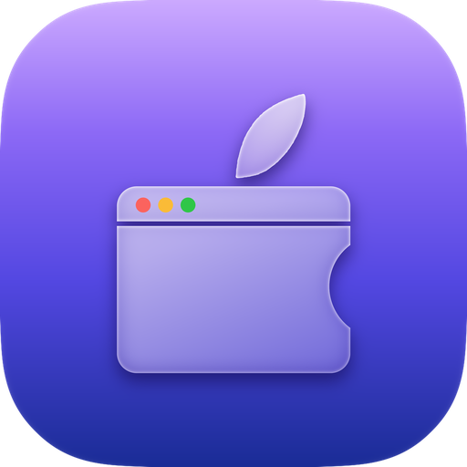

<div align="center">



# iLoader X

**Install SideStore and LiveContainer directly on your iPhone. No PC required.**

Bundle ID `com.iamgasgass.iloaderx` · iOS 17.4+ (iOS 27 pairs with itself)

[](https://iamgasgass.github.io/iLoaderX/)
[](https://github.com/iamgasgass/iLoaderX/releases/latest)
[](LICENSE.md)

</div>

---

iLoader X is a fork of **[SideInstaller by FrizzleM](https://github.com/FrizzleM/SideInstaller)**
(version 2.2.0, commit `08936ec`; first forked at 2.1.1, `141d7ee`), redistributed in source form under its
[licence](LICENSE.md). Everything that does the work (on-device pairing,
provisioning, signing and installing SideStore, LiveContainer and other IPAs)
is SideInstaller's; iLoader X gives it its own name, bundle ID and icon.

> [!IMPORTANT]
> iLoader X is **not** the official SideInstaller and is not affiliated with FrizzleM.
> For the original app, go to <https://github.com/FrizzleM/SideInstaller>.
> Problems with this fork belong in this repository's issues, not in SideInstaller's.

## Install

**Install page: <https://iamgasgass.github.io/iLoaderX/>** — add the source to
SideStore or AltStore, install in LiveContainer or TrollStore, or download the IPA.

| | |
|---|---|
| AltStore / SideStore source | `https://iamgasgass.github.io/iLoaderX/iloaderx.json` |
| Latest IPA (unsigned) | <https://github.com/iamgasgass/iLoaderX/releases/latest/download/iLoaderX.ipa> |

Then connect [LocalDevVPN](https://apps.apple.com/app/id6755608044), pair (iOS 27
pairs with itself; iOS 17.4 – 26 imports a pairing file made on a computer), sign
in with your Apple ID and install SideStore or LiveContainer from the Install tab.

## How to use it

[siboot](https://github.com/FrizzleM/siboot) (by FrizzleM, MIT) installs iLoader X from the
iPhone itself, signed with your own Apple account: no computer and no certificate. You need
**iOS 27 or later, Wi-Fi and Developer Mode on**, and an iLoader X release (siboot downloads
`releases/latest/download/iLoaderX.ipa` from this repository).

1. **Get the apps.** Install [rootshell](https://apps.apple.com/app/id6755794662),
   [Open Minis](https://apps.apple.com/app/id6759188481) and
   [LocalDevVPN](https://apps.apple.com/app/id6755608044), all free on the App Store.

2. **Pair in rootshell.** Turn on Settings › Location Diary Mode › Session Only in rootshell,
   then tap Local Shell and Open at the top right, and run these one line at a time:

   ```sh
   curl -fsSLO https://raw.githubusercontent.com/FrizzleM/siboot/main/rootshell/bin/siboot-pair.wasm
   ifconfig en0 > ifconfig.txt
   ./siboot-pair.wasm
   ```

   Open Settings › Privacy & Security › Developer Mode, scroll to the bottom, tap
   **Pair with siboot**, and enter your passcode and the code rootshell shows. Leave rootshell running.
   (With Open Minis 1.16 or later siboot can also pair the iPhone with itself in the next step.)

3. **Install from Open Minis.** Connect LocalDevVPN. In Open Minis, tap the console icon at the
   top right, then Shell Terminal, and run (one line):

   ```sh
   wget -qO- https://raw.githubusercontent.com/FrizzleM/siboot/main/minis/install.sh | sh -s -- --ipa https://github.com/iamgasgass/iLoaderX/releases/latest/download/iLoaderX.ipa
   ```

   The `--ipa` part is what makes siboot install **iLoader X** instead of SideInstaller.
   Type the transfer code rootshell shows (only the first time: after that, siboot uses the
   pairing file it saved), then your Apple account email, password and verification code. Keep
   Minis open until it says it's done. The first time, trust your Apple account in
   Settings › General › VPN & Device Management.

4. **Open iLoader X** from the Home Screen (siboot's last screen offers “Open SideInstaller”:
   that link is for SideInstaller, ignore it). With LocalDevVPN connected, log in with your Apple
   account and tap **Install SideStore** or **Install SideStore + LiveContainer**. siboot has
   already put the pairing file into iLoader X.

To install or refresh iLoader X again later, run `siboot --ipa https://github.com/iamgasgass/iLoaderX/releases/latest/download/iLoaderX.ipa`
in Open Minis (plain `siboot` would install SideInstaller). Once paired, `siboot developer-mode`
asks the iPhone to show the Developer Mode switch in Settings, or with `--turn-on` turns it on.

Already sideloading? Use the [install page](https://iamgasgass.github.io/iLoaderX/) instead:
SideStore / AltStore source, LiveContainer, TrollStore or the plain IPA.

## The icon

Drawn from scratch for iLoader X: a garnet rounded “L” with a download arrow landing on
a tray in the notch. Two looks, each with every appearance iOS asks for; the app's tool
tiles (Apps, Certificates, Downloads, Entitlements, Location, Pairing, Side by Side,
JIT, Sources) are
drawn in the same glass design (`tools/icon/tools.mjs`), and the whole app is garnet
(`ios-app/Theme.swift`, `AccentColor`):


| | Where | Variants |
|---|---|---|
| **Liquid Glass** (primary) | `ios-app/Assets.xcassets/AppIcon.appiconset` | the same artwork as the in-app logo (`AppLogo`): Default, Dark (the in-app dark tile) and Tinted, at every iPhone, iPad, CarPlay and App Store size; iOS 26 derives Clear from it |
| **iOS 6** (alternate) | `ios-app/Assets.xcassets/AppIcon-iOS6.appiconset` | linen backdrop, beveled garnet gel “L”, embossed gunmetal arrow, the gloss arc baked in; every size, plus Dark (chrome arrow on charcoal) and Tinted |

Switch between them in **Settings › App Icon**. The artwork is generated from
code, so it can be regenerated at any size:

```sh
node tools/icon/render.mjs build/icon        # masters + Icon Composer layers + preview sheet (Playwright/Chromium)
python3 tools/icon/build_assets.py build/icon # asset catalog sets (icons, logo, tool tiles), docs/
```

## Building

iLoader X builds with **Xcode 27.2 and the iOS 27.2 SDK**, with Rust (`aarch64-apple-ios`) and `xcodegen`:

```sh
scripts/build-ipa.sh     # → build/iLoaderX.ipa, unsigned
```

On GitHub, `.github/workflows/build.yml` (modelled on Henge X's `build-ipa.yml`) runs on
GitHub's **`xcode-27`** image (macOS 27):

| Trigger | What it does |
|---|---|
| push to `main` or `claude/**` | builds `iLoaderX.ipa` and `iLoaderX.tipa` (TrollStore, ad hoc signed), kept as artifacts |
| push of a tag `v1.0.0` | the same, plus release `v1.0.0` with both files, the AltStore/SideStore source updated and the install page redeployed |
| Actions › Build IPA › Run workflow | the same from the branch you pick; tick **release** (with a version and notes) to publish |

The Xcode step lists every Xcode on the runner, picks 27.2 and fails if the iOS SDK isn't 27.2;
the repository variables `ILOADERX_XCODE` and `ILOADERX_IOS_SDK` change them (e.g. to a newer
27.x when GitHub adds it). `checks.yml` (Rust tests, simulator build, translations) runs on the same
image; `pages.yml` publishes `site/` to GitHub Pages (Settings › Pages › Source: **GitHub Actions**).

## What this fork changes

Compared with SideInstaller 2.2.0 (`08936ec`), as its licence asks:

- **Name**: “iLoader X” everywhere the app shows its name, in all ten languages
  (product/target `iLoaderX`, `iLoaderXTests`, `iLoaderXLiveActivity`; the
  pairing name in Settings › Developer Mode and the certificate's machine name
  are “iLoader X”).
- **Identifiers**: bundle ID `com.iamgasgass.iloaderx` (Live Activity
  `.LiveActivity`, tests `.tests`); URL scheme `iloaderx://`; document types
  `com.iamgasgass.iloaderx.ipa` / `.mobiledevicepairing`; keychain service
  `com.iamgasgass.iloaderx.appleID`. It installs beside SideInstaller and shares
  nothing with it.
- **Icon**: new artwork, Liquid Glass primary and iOS 6 alternate (above), the
  in-app logo, and a Settings › App Icon picker (`ios-app/AppIconPicker.swift`).
- **Links**: update banner, Side by Side, problem reports, source-code link and
  terms use `iamgasgass/iLoaderX` and its install page, not FrizzleM's.
- **Official-source check**: points to iamgasgass.github.io/iLoaderX instead of
  sideinstaller.net.
- **Install page and source**: `site/` (install page in English and Italian, terms,
  AltStore/SideStore source `iloaderx.json`) replaces sideinstaller.net and
  `frizzlem.json`.
- **About**: links this fork's source and credits SideInstaller by FrizzleM.
- **SideInstaller 2.2.0** (JIT, Sources, Shortcuts, ARMSX3 pairing, a current Mac for
  sign-in) merged in with all of the above kept: its default source is iLoader X's
  (`site/iloaderx.json`), its links are `iloaderx://`, and its JIT and Sources tiles are
  redrawn in the garnet glass design.
- **How to use it**: the siboot route, with `--ipa` pointing at iLoader X's release.
- **Removed** what only the official SideInstaller publishes: the
  sideinstaller.net pages, the AltSource (`frizzlem.json`), the DNS profile, and
  the release/signing/Pages workflows. Added `build.yml`, `pages.yml` and
  `scripts/update_source.py`.
- Internal names that never show (the Rust core, `SideInstallerFFI`, Swift type
  names) are unchanged, so upstream changes merge cleanly.

## Licence

[SideInstaller License](LICENSE.md), © 2026 FrizzleM: non-commercial; source
redistribution with this licence, attribution and the changes listed above. iLoader X
is not sold or monetized in any way.
