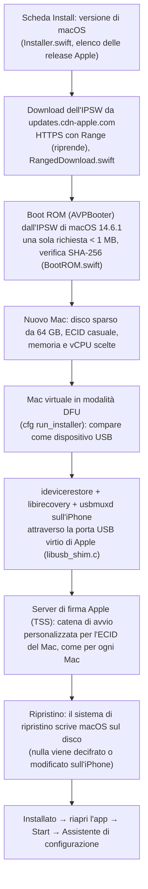
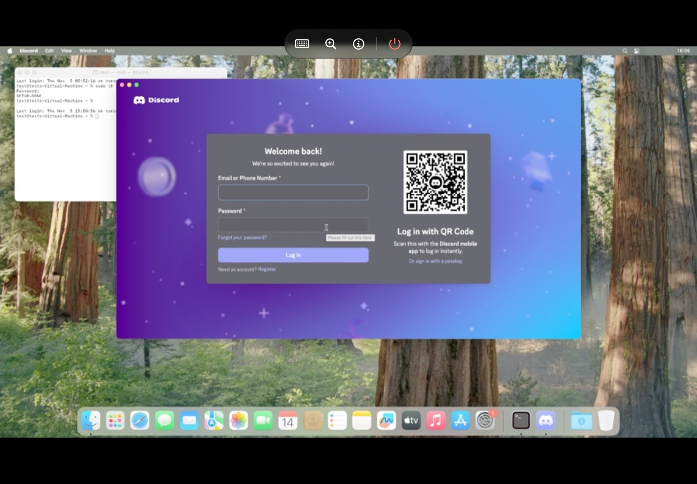
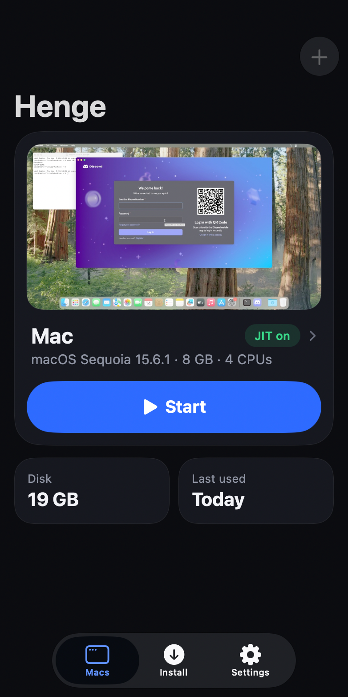
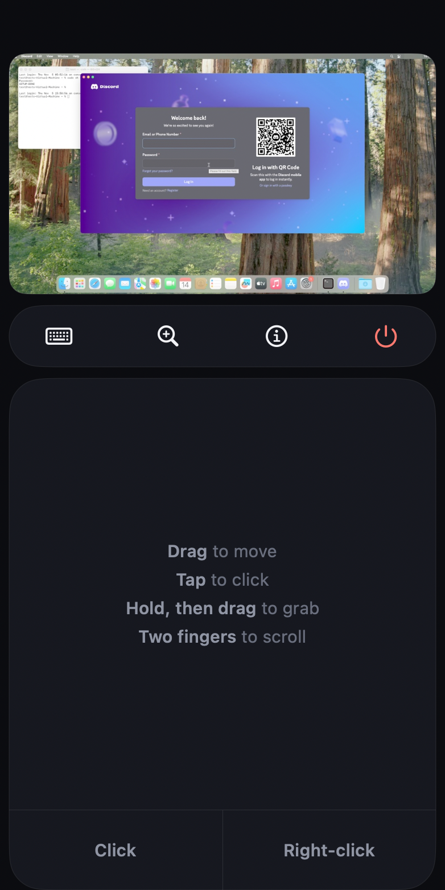
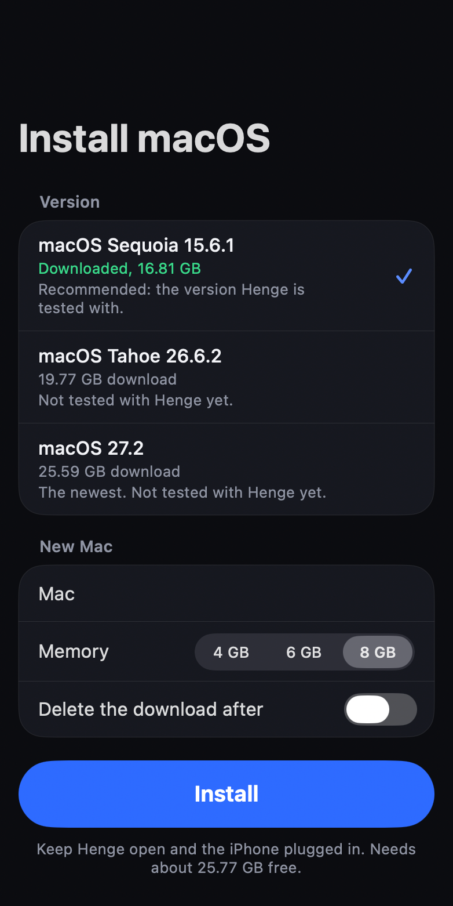

<div align="center">


# macOSiOS X

**macOS su iPhone e iPad, senza jailbreak, senza Mac e senza PC.**
Si installa direttamente sul telefono, dai server di Apple.

`com.iamgasgass.macosiosx` · iOS 17+ · chip A14 / M1 o successivo · licenza GPL

</div>

---

> **In una riga:** macOSiOS X è la copia di [WindowsiOS X](../../tree/claude/nice-johnson-xmx741) (branch
> `claude/nice-johnson-xmx741`) in cui **Windows 11 è sostituito da macOS** in ogni sua parte: sistema ospite,
> installazione, tastiera, scorciatoie, icona, nomi. Il motore che fa girare macOS è quello di
> [Henge](https://github.com/Leviidev/Henge) (branch `henge` di questo repository), l'unico che emula la
> piattaforma *vmapple* su cui macOS per Apple silicon si avvia.

## Indice

1. [Cos'è](#1-cosè)
2. [Cosa cambia rispetto a WindowsiOS X](#2-cosa-cambia-rispetto-a-windowsios-x)
3. [Dispositivi compatibili](#3-dispositivi-compatibili)
4. [Installazione passo per passo](#4-installazione-passo-per-passo)
5. [Come funziona l'installazione sull'iPhone](#5-come-funziona-linstallazione-sulliphone)
6. [Cartella condivisa e appunti](#6-cartella-condivisa-e-appunti)
7. [Impostazioni: memoria, vCPU, prestazioni](#7-impostazioni-memoria-vcpu-prestazioni)
8. [Interfaccia: modalità Laptop e Studio](#8-interfaccia-modalità-laptop-e-studio)
9. [Aggiornare, reinstallare, migrare](#9-aggiornare-reinstallare-migrare)
10. [Risoluzione dei problemi](#10-risoluzione-dei-problemi)
11. [Compilare l'app](#11-compilare-lapp)
12. [Struttura del repository](#12-struttura-del-repository)
13. [Cosa è verificato e cosa no](#13-cosa-è-verificato-e-cosa-no)
14. [Il motore (da Henge)](#14-il-motore-da-henge)
15. [Crediti e licenze](#15-crediti-e-licenze)

---

## 1. Cos'è

macOSiOS X esegue **macOS originale e non modificato** (Ventura, Sonoma, Sequoia, Tahoe, macOS 27) dentro
un'app iOS. Non usa `Hypervisor.framework` né `Virtualization.framework`, che sugli iPhone non jailbroken non
ci sono. Usa invece:

- un **traduttore binario dinamico ARM64 → ARM64** (JIT) con MMU software, scritto per quello che chiede il
  kernel di macOS (XNU);
- un **Mac virtuale completo** sul modello della macchina `vmapple` (quella dei Mac virtuali di Apple):
  boot ROM di Apple (AVPBooter), iBoot, GICv3, PCIe, disco VirtIO, rete, audio, USB con tastiera e
  **Magic Trackpad 2**, e la **GPU paravirtuale** di Apple, i cui comandi vengono rieseguiti con **Metal**;
- un'**interfaccia iOS** che fa da MacBook: schermo del Mac sopra, **tastiera Mac e trackpad sotto**.

Il JIT richiede un debugger collegato per avere memoria eseguibile (iOS 26/27 con TXM): si attiva con
[StikDebug](https://github.com/StephenDev0/StikDebug), con TrollStore, con un jailbreak o con l'**helper JIT
integrato** nell'app (iOS 26 o successivo, abbinamento sul dispositivo).

## 2. Cosa cambia rispetto a WindowsiOS X

| | WindowsiOS X | **macOSiOS X** |
| :--- | :--- | :--- |
| Sistema ospite | Windows 11 Pro ARM64 | **macOS** 13.6 – 27.2 (consigliato **Sequoia 15.6.1**) |
| Piattaforma virtuale | PC UEFI (EDK2, ACPI, NVMe, xHCI, HDA) | **Mac virtuale `vmapple`** (AVPBooter, iBoot, VirtIO, GPU paravirtuale Apple) |
| Motore | WindowsiOS (`ammaarreshi/WindowsiOS`) | **Henge** (`Leviidev/Henge`), con le correzioni del branch `henge` |
| Download | ESD dal catalogo Microsoft, HTTP + SHA-1 | **immagine di ripristino (IPSW) dai server Apple**, HTTPS, con ripresa |
| Installazione | disco WinPE scritto sull'iPhone (wimlib + FatFs), `startnet.cmd`, `unattend.xml` | **ripristino come su un Mac vero**: modalità DFU, `idevicerestore`, firma personalizzata da Apple (TSS) |
| Firmware | EDK2 di QEMU, incluso nell'app | **boot ROM di Apple scaricata da Apple** all'installazione, verificata con SHA-256, mai inclusa nell'app |
| Driver di rete | NetKVM + disco "Tools" | **nessuno**: macOS ha già i driver VirtIO |
| Disco ausiliario | WINIOSTOOLS (D:) | **cartella condivisa** (File › macOSiOS X › Shared ↔ `~/Henge` sul Mac) e **appunti** condivisi |
| Tastiera del deck | Surface Laptop: Ctrl, Fn, ⊞ Win, Alt | **Magic Keyboard**: fn/🌐, ⌃ control, ⌥ option, ⌘ command |
| Tasti funzione | Start, Cerca, Esplora file, Edge, Paint… | **Spotlight, Finder, Safari, Terminale, Mission Control, Scrivania…** ([§8](#8-interfaccia-modalità-laptop-e-studio)) |
| Trackpad | tablet assoluto USB | **Magic Trackpad 2**: i gesti di macOS (2 dita scorre, 3 dita Spaces/Mission Control) |
| Memoria per l'ospite | 2 – 4,5 GB in base alla RAM | **2 – 8 GB** in base alla RAM, modificabile per ogni Mac |
| vCPU | 2 – 4 | fino a **core del dispositivo − 1** (massimo 6) |
| Chip troppo vecchio | messaggio all'avvio | uguale: messaggio chiaro su A13 e precedenti |
| Interfaccia | verticale = Laptop, orizzontale = Studio | **uguale**, più selettore del deck Laptop / Trackpad / Tastiera |
| iPhone Duo | sensore cerniera (`UIHingeInteraction`) | **uguale**: piegato a portatile → Laptop |
| Riga del dispositivo | `IPHONE 14 PRO · 6 GB · 2560 MB / 4 VCPU` | `IPHONE 14 PRO · 6 GB · 3 GB / 5 VCPU` |
| Firma | firma automatica, bundle ID `com.iamgasgass.windowsiosx` | firma automatica, bundle ID **`com.iamgasgass.macosiosx`** |
| Compilazione | GitHub Actions → `WindowsiOS-X.ipa` | GitHub Actions → **`macOSiOS-X.ipa`** e **`macOSiOS-X.tipa`** (TrollStore) |
| Icona | logo Windows con morso e foglia | **finestra macOS** (barra del titolo, tre "semafori") con morso e foglia |
| Nome | WindowsiOS X | **macOSiOS X** |

Rispetto a Henge, macOSiOS X aggiunge: il **deck Laptop** con tastiera Mac completa e trackpad, la
**modalità Studio** con il pulsante per tornare a Laptop, il **sensore cerniera** dell'iPhone Duo, la **riga del
dispositivo** nella schermata iniziale, il nome, l'icona, il bundle ID, il workflow `build-ipa.yml` e questa
documentazione in italiano.

## 3. Dispositivi compatibili

La regola è la stessa di WindowsiOS X e di Henge: **iOS 17 o successivo, chip A14 / M1 o più recente**. La CPU
virtuale dichiara a macOS istruzioni Armv8.5 (`core/sysreg.c`) e il JIT le passa così come sono al processore
dell'iPhone. Un A13 o precedente non le ha: l'app lo rileva dal modello e mostra
*"macOS won't run on this iPhone. macOSiOS X needs an A14 or M1 chip or newer."*

| RAM del dispositivo | iPhone / iPad | Memoria proposta per un nuovo Mac | vCPU (auto) | Stato |
| :--- | :--- | :---: | :---: | :--- |
| 16 GB | iPad Pro M4/M5 da 16 GB | 8 GB | 6 | ✅ |
| 12 GB | iPhone 17 Pro / Pro Max, iPhone Air, **iPhone Duo** | 6 GB | 5 | ✅ (motore provato su **iPhone 17 Pro**) |
| 8 GB | iPhone 15 Pro / Pro Max, 16 / 16 Plus / 16 Pro / 16 Pro Max / 16e, 17; iPad M1–M4 da 8 GB | 4 GB | 5 (6 su iPad) | ✅ |
| 6 GB | iPhone 12 Pro / Pro Max, 13 Pro / Pro Max, 14 / 14 Plus / 14 Pro / Pro Max, 15 / 15 Plus | 3 GB | 5 | ⚠️ macOS è lento sotto i 4 GB |
| 4 GB | iPhone 12 / 12 mini, 13 / 13 mini, SE (3ª gen.) | 2 GB | 5 | ⚠️ sperimentale, usa **Ventura** |
| — | iPhone 11 e precedenti (A13 o più vecchi) | — | — | ❌ chip troppo vecchio |

La fascia si sceglie dalla RAM che il dispositivo dichiara, non dal nome del modello: i modelli futuri sono
coperti automaticamente. Le vCPU sono al massimo **i core del dispositivo meno uno** (uno resta a interfaccia,
audio e schermo), mai più di 6. Se all'avvio la memoria non si riesce a riservare, l'app riprova scendendo di
512 MB alla volta, come WindowsiOS X.

**Spazio libero necessario** (download + disco del Mac; il download si può cancellare dopo):

| Versione | Download | Totale circa |
| :--- | :---: | :---: |
| macOS Ventura 13.6 | 12,3 GB | 35 GB |
| macOS Sonoma 14.6.1 | 14,1 GB | 40 GB |
| **macOS Sequoia 15.6.1** (consigliata) | 16,0 GB | **43 GB** |
| macOS Tahoe 26.6.2 | 18,9 GB | 45 GB |
| macOS 27.2 | 24,4 GB | 51 GB |

## 4. Installazione passo per passo

**Servono:** un iPhone o iPad compatibile con lo spazio della tabella sopra, SideStore / AltStore / TrollStore,
un modo per il JIT (StikDebug, TrollStore, jailbreak o l'helper integrato su iOS 26+), Wi-Fi e il dispositivo in
carica.

1. **Installa l'app.** Scarica `macOSiOS-X.ipa` da GitHub (*Actions → Build IPA → ultima run → Artifacts*,
   oppure dalla pagina *Releases*) e caricala con SideStore o AltStore; con TrollStore usa `macOSiOS-X.tipa`.
2. **Aprila.** In cima alla scheda *Macs* vedi il modello, la RAM e cosa riceverà un Mac, ad esempio
   `IPHONE 14 PRO · 6 GB · 3 GB / 5 VCPU`. Toccando quella riga apri le impostazioni.
3. **Attiva il JIT** dalla scheda *Settings › JIT* (il metodo *Automatic* sceglie da solo tra StikDebug,
   TrollStore, jailbreak e helper integrato) o con *Turn On JIT* nella scheda *Macs*.
4. **Apri la scheda _Install_.** La schermata è quella di Henge:
   - **Versione:** da Ventura 13.6 a macOS 27.2; consigliata **Sequoia 15.6.1**;
   - **Nome** del Mac, **memoria** (proposta in base al dispositivo) e **vCPU**;
   - **Elimina il download dopo l'installazione:** libera da 12 a 24 GB;
   - in fondo l'app indica **quanto spazio serve e quanto ne hai libero**.
5. **Tocca _Install_.** L'app:
   1. scarica l'immagine di ripristino di macOS dai server di Apple (riprende se si interrompe);
   2. scarica dalla stessa immagine Apple la **boot ROM** del Mac virtuale e ne verifica lo SHA-256;
   3. avvia il Mac virtuale in **modalità DFU** e lo **ripristina** come farebbe un Mac (*Write macOS*).
   **Tieni l'app aperta e il dispositivo in carica.**
6. **Chiudi l'app** (scorri verso l'alto) e riaprila, come dice il messaggio finale: un solo Mac può avviarsi
   per ogni apertura dell'app.
7. **Tocca _Start_.** Al primo avvio compare l'**Assistente di configurazione** di macOS: lingua, tastiera,
   account. Su Sequoia, su iPhone 17 Pro, macOS arriva alla schermata di blocco in circa 15 secondi.

## 5. Come funziona l'installazione sull'iPhone



- **Nessun Mac necessario**: è lo stesso ripristino che fa `Virtualization.framework`, eseguito sull'iPhone.
- **Nulla di Apple è incluso nell'app**: macOS e la boot ROM si scaricano da Apple durante l'installazione;
  `package_ipa.sh` rifiuta di creare un'IPA che contenga la boot ROM.
- Dettagli tecnici: [docs/architecture.md](docs/architecture.md) (*Installing macOS*, *The boot ROM*).

## 6. Cartella condivisa e appunti

È l'equivalente del disco "WindowsiOS X Tools", ma per macOS non servono driver: serve solo collegare i file e
gli appunti.

- **Configurazione (una volta per ogni Mac):** apri *Terminale* nel Mac, poi in macOSiOS X apri *Details* e tocca
  **Type the Set Up Command**; premi Invio nel Mac e scegli *Consenti* quando macOS chiede di `henge-agent` e
  delle reti locali. Serve la tastiera del Mac in layout **U.S.** per quel momento.
- **Cartella:** File › *macOSiOS X* › *Shared* sull'iPhone è la stessa cartella di `~/Henge` nel Mac.
- **Appunti:** ciò che copi nel Mac arriva sull'iPhone; il pulsante *Incolla* della barra incolla dall'iPhone
  nel Mac (iOS non chiede permessi per quel pulsante).
- Il server è un piccolo WebDAV su un socket Unix interno all'app: nessuna porta TCP aperta, le altre app non
  lo raggiungono.

## 7. Impostazioni: memoria, vCPU, prestazioni

**Memoria e vCPU di un Mac:** tocca la scheda del Mac nella schermata *Macs*. La memoria va da 1 a 16 GB
(l'app avvisa sotto i 4 GB e sopra quella proposta per il dispositivo); le vCPU da 1 a *core − 1*. Valgono al
prossimo avvio del Mac.

**Settings › Memory** mostra il limite di memoria di iOS per l'app e quanto è libero. L'entitlement
`increased-memory-limit` è consigliato, non obbligatorio.

**Settings › Performance:**
- *Mac refresh rate* 30 / 60 / 120 Hz (60 predefinito: ogni fotogramma di macOS è emulato);
- *Faster disk writes*, *Quicker wake from idle*, *Superblocks* (sperimentale);
- *Code cache*: dimensione della cache del codice tradotto (scelta in base al limite di memoria).

**Settings › Instant Resume:** quando esci dall'app il Mac viene salvato e riprende in pochi secondi.
**Consiglio:** per più velocità, in macOS usa uno **sfondo fisso** e imposta il salvaschermo su *Mai*.

## 8. Interfaccia: modalità Laptop e Studio

L'interfaccia della sessione copia quella del video di Huy Nguyen
([x.com/little_34306](https://x.com/little_34306/status/2120923267699761294): macOS 27.2 sull'iPhone Duo
piegato a metà, con Henge e una tastiera sul secondo schermo).

- **In verticale — Laptop:** il Mac nella metà superiore e, subito sotto, il **deck di un MacBook** color
  ardesia-lilla, fino al bordo inferiore: maniglia al centro in alto, quattro piccoli pulsanti in alto a destra
  (**tastiera** di iOS, **laptop**, **info**, **spegnimento** in rosso), la **tastiera MacBook** con la sua vera
  riga funzioni e sotto un **trackpad grande**. Il pulsante *laptop* passa alla **modalità Trackpad**: sul deck
  la barra degli strumenti (nascondi, tastiera, laptop, incolla, zoom, info, spegnimento) e il trackpad con le
  istruzioni e i pulsanti *Click* / *Right-click*; lo stesso pulsante riporta la tastiera.
- **In orizzontale — Studio:** il Mac a schermo intero; lo schermo stesso è il trackpad. Il pulsante
  **Laptop** nella barra riporta in verticale.
- **iPhone Duo:** la postura viene letta dal sensore della cerniera (`UIHingeInteraction`, iOS 27.1): piegato a
  portatile, la sessione si mette in verticale (Laptop), come nel video. Il codice si compila solo se l'SDK di
  Xcode contiene quell'API; altrimenti il Duo usa la stessa logica degli altri iPhone.
- **iPad:** Studio, con tastiera e trackpad/mouse fisici; il deck resta disponibile in verticale.

**Riga funzioni** (come su un MacBook; con **fn** attivo inviano F1–F12):

| Tasto | Azione |
| :--- | :--- |
| esc | `esc` |
| ☼ − / ☼ + | luminosità dello schermo del Mac sul dispositivo |
| Mission Control | `⌃ ↑` |
| 🔍 | Spotlight (`⌘ Spazio`) |
| 🎤 dettatura, 🌙 Non disturbare | inviano `F5`, `F6` |
| ⏪ ⏯ ⏩ | inviano `F7`, `F8`, `F9` |
| 🔇 🔉 🔊 | **muto, volume giù, volume su** di macOS (tasti USB veri) |
| Touch ID | blocca lo schermo (`⌃ ⌘ Q`) |

I tasti multimediali e di luminosità di una tastiera Apple usano una pagina USB che la tastiera virtuale del
motore non ha: per questo luminosità agisce sullo schermo dell'app e ⏪ ⏯ ⏩ / dettatura / Non disturbare
inviano i tasti F corrispondenti. Muto e volume arrivano a macOS come su un Mac.

Riga inferiore come su un MacBook: **fn/🌐 · ⌃ control · ⌥ option · ⌘ command · spazio · ⌘ · ⌥ · ← ↑↓ →**.
⌃ ⌥ ⌘ e ⇧ restano "agganciati" dopo un tocco (spia verde) fino al tasto o al clic successivo: con un dito solo
si fanno `⌘C`, `⌘V`, `⌘-clic`. **caps lock** ha la sua spia. Con **fn**: ← = home, → = end, ↑ = pagina su,
↓ = pagina giù, delete = cancella a destra. I tasti tenuti premuti si ripetono come su un Mac.

**Trackpad** (sia nel deck che a schermo intero): è un **Magic Trackpad 2** per macOS. Tocco = clic, tocco con
due dita = clic destro, tieni premuto e trascina = trascina, due dita = scorri, tre dita = Spaces, Mission
Control, App Exposé, **quattro dita** = mostra i controlli nascosti. In *Settings › Trackpad* i tasti volume
possono fare da pulsanti (su = clic, giù = clic destro).

## 9. Aggiornare, reinstallare, migrare

| Azione | Il Mac resta? | Cosa fare |
| :--- | :--- | :--- |
| **Aggiornare** l'IPA sopra l'app esistente (stesso bundle ID) | ✅ sì | niente |
| **Cancellare** l'app e reinstallarla | ❌ no, iOS cancella i dati | prima esporta il Mac (sotto) |
| Passare da **Henge** (`com.henge.app` o altro) a **macOSiOS X** | ❌ per iOS è un'altra app | esporta da Henge e importa in macOSiOS X |

**Esportare / importare un Mac:**
1. Spegni il Mac. Nella sua scheda tocca **Export** (finisce in File › *macOSiOS X* › *Exports*), poi
   **Move Out of macOSiOS X…** per spostarlo fuori dall'app.
2. Nella nuova app: **+** › *Bring in a Mac from a computer…* e scegli la cartella esportata.
   Un Mac creato su un Mac vero si prepara con `tools/export_ios.sh DISK AUX ECID [NOME]`.

## 10. Risoluzione dei problemi

| Sintomo | Causa | Soluzione |
| :--- | :--- | :--- |
| *"macOS won't run on this iPhone … A14 or M1"* | chip A13 o precedente | non risolvibile: servono le istruzioni Armv8.5 |
| *JIT off* / il Mac non parte | JIT non attivo | *Settings › JIT*; con StikDebug apri l'app da macOSiOS X, non dall'elenco di StikDebug |
| iOS chiude l'app durante *Write macOS* o l'uso | memoria | abbassa la memoria del Mac; firma con `increased-memory-limit` |
| *"Not enough free space"* | vedi tabella in [§3](#3-dispositivi-compatibili) | libera spazio o scegli Ventura/Sonoma; il download parziale riprende |
| *"The partial download did not match Apple's file"* | download danneggiato | riparte da solo |
| *"…boot ROM from Apple…"* | rete o file inatteso | controlla la connessione e riprova |
| Il Mac non riparte dopo l'installazione o lo spegnimento | un solo Mac per apertura dell'app | chiudi l'app scorrendo e riaprila |
| Accesso all'Account Apple in macOS fallisce | limite noto del motore | usa un account locale |
| macOS lento nei primi minuti | macOS lavora in background dopo il login | aspetta; usa sfondo fisso e salvaschermo *Mai* |
| ⌘Tab non arriva su iPad | iPadOS tiene per sé alcune scorciatoie | usa **F7** del deck |

## 11. Compilare l'app

### Su GitHub Actions (consigliato, non serve un Mac)
`.github/workflows/build-ipa.yml` parte a ogni push su `main` e `claude/**`, su ogni tag `macosiosx-v*` e a
mano (*Run workflow*). Su `macos-26`:
1. **Xcode più recente** del runner (beta comprese, minimo 26; la variabile `MACOSIOSX_XCODE` lo fissa);
2. librerie iOS compilate da [Husk](https://github.com/Leviidev/Husk) e messe in cache: libffi, glib, libslirp,
   libreria di abbinamento, StikJIT;
3. stack di ripristino (`tools/build_ios_restore.sh`): libirecovery, usbmuxd, idevicerestore e dipendenze;
4. `make ios-lib` → motore;
5. **prove dell'SDK**: compila un file Swift di una riga per `UIHingeInteraction` (→ `MACOSIOSX_HINGE`) e per
   l'accessorio di scena iOS 27 (→ `HENGE_SCENE_ACCESSORY`);
6. app non firmata, poi firma ad hoc con gli entitlement → **`macOSiOS-X.ipa`** e **`macOSiOS-X.tipa`**;
7. artifact `macOSiOS-X-<versione>-<commit>`; con un tag `macosiosx-v*` (o *release* manuale) anche una
   GitHub Release.

Il pulsante *Run workflow* compare solo se il workflow si trova sul branch predefinito del repository.

### Su un Mac (Apple Silicon)
```sh
brew install xcodegen meson ninja pkg-config cmake
# Husk compilato in ~/Documents/Coding/Husk (oppure HUSK=/percorso)
ios/scripts/fetch_deps.sh
tools/build_ios_restore.sh
make ios-lib
MACOSIOSX_TEAM_ID=XXXXXXXXXX ios/scripts/package_ipa.sh        # → ~/Desktop/macOSiOS-X.ipa
ios/scripts/package_ipa.sh --trollstore                         # → ~/Desktop/macOSiOS-X.tipa
```
Il bundle ID è `com.iamgasgass.macosiosx`. Gli entitlement sono `get-task-allow` (JIT),
`dynamic-codesigning`, `increased-memory-limit` (consigliato) ed `extended-virtual-addressing`; con un team
personale gratuito usa `Henge/Henge.personal.entitlements` (vedi [ios/README.md](ios/README.md)).

`make` compila il motore per Mac (`build/hengevm`) e `make test` ne esegue i test.

## 12. Struttura del repository

```text
macOSiOS X/
├── core/                 motore JIT ARM64→ARM64, MMU software, registri di sistema (da Henge)
├── devices/              Mac virtuale vmapple: GICv3, PCIe, VirtIO, xHCI (tastiera + Magic Trackpad 2),
│                         AES, cfg, bdif, USB virtio, GPU paravirtuale (pvg_lite.c + pvg_metal.m)
├── host/                 memoria, regione JIT, dischi, rete slirp + DNS, condivisione WebDAV, installazione
├── ios/
│   ├── project.yml          progetto XcodeGen (nome visibile, bundle ID, entitlement)
│   ├── scripts/package_ipa.sh  build + prove dell'SDK + firma ad hoc → macOSiOS-X.ipa / .tipa
│   ├── Henge/               l'app (i nomi interni restano quelli di Henge)
│   │   ├── MacKeyboardDeck.swift  deck Laptop: tastiera Mac + trackpad, Studio, rotazione
│   │   ├── HingeSensor.swift      sensore cerniera dell'iPhone Duo (MACOSIOSX_HINGE)
│   │   ├── SessionView.swift      sessione: Laptop / Studio, barra, zoom, dettagli
│   │   ├── HomeView.swift         schermata Macs, riga del dispositivo
│   │   ├── Hardware.swift         profilo del dispositivo: RAM, vCPU, chip, tastiera e mouse fisici
│   │   ├── Installer.swift, InstallView.swift, BootROM.swift, RangedDownload.swift   installazione
│   │   ├── Trackpad.swift, VolumeClicks.swift, Input.swift   input
│   │   ├── JIT/                   StikDebug, TrollStore, helper integrato, abbinamento
│   │   └── Assets.xcassets/AppIcon.appiconset   icona (chiara, scura, tinta)
│   └── HengeJITHelper/      estensione con StikJIT per il JIT integrato (iOS 26+)
├── tl/                   livello di traduzione per app Mac senza macOS (sperimentale)
├── tools/
│   ├── icon/render_macos.py   generatore dell'icona
│   ├── henge-agent.m          helper dentro macOS per cartella condivisa e appunti
│   └── build_ios_restore.sh, export_ios.sh, …
├── third_party/          idevicerestore, libimobiledevice, libirecovery, usbmuxd, libplist, mbedtls, libzip…
├── tests/                test del motore
├── docs/                 architettura, licenze, icona, changelog di Henge
├── .github/workflows/build-ipa.yml   build dell'IPA
└── CHANGELOG.md          cronologia delle versioni di macOSiOS X
```

## 13. Cosa è verificato e cosa no

| Parte | Stato |
| :--- | :--- |
| Motore Henge: installazione e avvio di Sequoia, Tahoe, macOS 27, Sonoma, Ventura su **iPhone 17 Pro** | ✅ verificato a monte (Henge) |
| Compilazione di `macOSiOS-X.ipa` e `.tipa` su GitHub Actions (`macos-26`) | ✅ verificato (run #12, commit `2ef2084`) |
| Deck Laptop (tastiera Mac + trackpad), Studio, rotazione, riga del dispositivo | ⏳ da provare su dispositivo |
| iPhone da 4 e 6 GB | ⏳ non ancora provati con macOS |
| Sensore cerniera dell'iPhone Duo | ⏳ richiede l'SDK iOS 27.1 nel runner |
| Accesso all'Account Apple dentro macOS | ❌ limite noto del motore |

Le segnalazioni da altri dispositivi sono benvenute: apri una issue con modello, versione di iOS e di macOS e
screenshot.

## 14. Il motore (da Henge)

Le parti difficili sono di [Leviidev/Henge](https://github.com/Leviidev/Henge) e dei suoi fork della comunità
(raccolti nel branch `henge`, vedi [docs/CHANGELOG-Henge.md](docs/CHANGELOG-Henge.md)) e restano invariate:

- **traduttore a blocchi** ARM64 → ARM64: la maggior parte delle istruzioni viene copiata; si riscrivono
  load/store (MMU con TLB in linea), salti, registri di sistema, eccezioni e autenticazione dei puntatori;
  pagine da 16 KB come l'host;
- **macchina `vmapple`** sul modello di QEMU (`hw/vmapple`), nulla da `Virtualization.framework`;
- **GPU**: i comandi della GPU paravirtuale di Apple rieseguiti con Metal; Safari, Chrome, Firefox, VS Code e
  Discord disegnano;
- **Magic Trackpad 2** sul bus USB xHCI, con il formato multitouch di Apple;
- **identità del Mac**: *Informazioni su questo Mac* può mostrare il modello e il chip del dispositivo;
- **installazione senza Mac**: ripristino DFU con idevicerestore sull'iPhone;
- **schermo esterno** via USB-C/HDMI, **iPad** con Magic Keyboard, **Instant Resume**.

Architettura: [docs/architecture.md](docs/architecture.md). Spegnimento: [docs/guest-shutdown.md](docs/guest-shutdown.md).

<table>
  <tr>
    <td align="center" colspan="3"><br><sub>Motore Henge: Discord su iPad</sub></td>
  </tr>
  <tr>
    <td align="center" width="33%"><br><sub>Macs</sub></td>
    <td align="center" width="33%"><br><sub>Trackpad</sub></td>
    <td align="center" width="33%"><br><sub>Installazione di macOS</sub></td>
  </tr>
</table>

<sub>Schermate di Henge, il motore di macOSiOS X; l'interfaccia di macOSiOS X aggiunge il deck Laptop.</sub>

## 15. Crediti e licenze

- **Henge** — [Leviidev/Henge](https://github.com/Leviidev/Henge) e i fork della comunità: motore, app, installazione.
- **Husk** — [Leviidev/Husk](https://github.com/Leviidev/Husk): JIT, log, abbinamento, idea dell'icona.
- **WindowsiOS X** — branch `claude/nice-johnson-xmx741`: deck Laptop, sensore cerniera, profilo del
  dispositivo, struttura di questo README; a sua volta da [ammaarreshi/WindowsiOS](https://github.com/ammaarreshi/WindowsiOS).
- **StikJIT / StikDebug** (MPL-2.0, idevice MIT), **idevicerestore, libimobiledevice, libirecovery, usbmuxd,
  libplist** (LGPL/GPL), **QEMU** `vmapple` come riferimento.

Licenza **GPL-2.0-or-later**: l'app include usbmuxd (GPLv2 o GPLv3) e codice di Husk (GPL-2.0-or-later), quindi
il binario è un'opera GPL combinata e non può andare sull'App Store. Vedi [docs/licensing.md](docs/licensing.md).

**macOS e la boot ROM del Mac sono di Apple e non fanno parte di macOSiOS X**: l'app li scarica da Apple durante
l'installazione. macOS, Mac, iPhone, iPad, Safari, Finder, Spotlight e Mission Control sono marchi di Apple Inc.;
Windows è un marchio di Microsoft. Questo progetto non è affiliato né all'una né all'altra.
